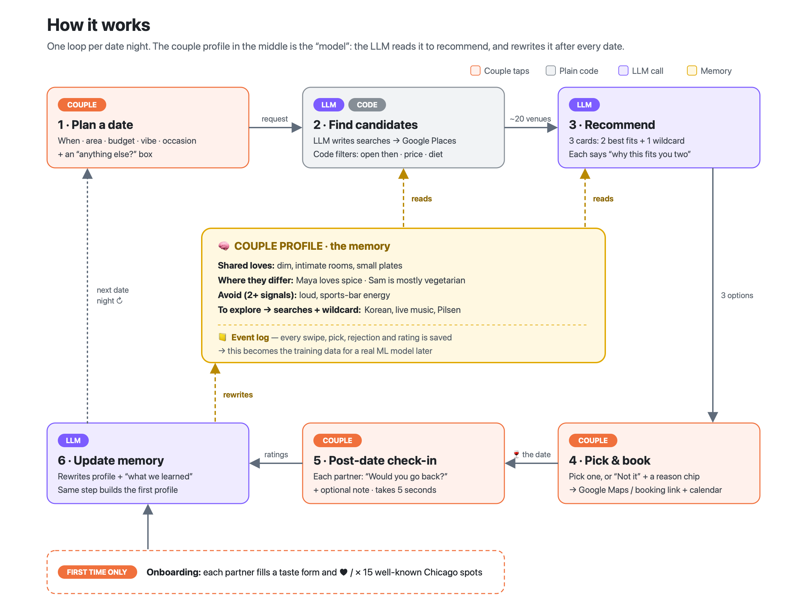

# Date Planner — MVP Implementation Plan

*Group 22 · BUSN 43120 · Draft by Arnav, for team review*

The goal is the smallest prototype that makes the core idea feel real in a demo: **the app knows you as a couple, picks a date you'd both like, and gets smarter after every date.** Everything else is cut.

### Decisions made

| Question | Decision |
|---|---|
| Scope | **Restaurants and bars only** |
| Geography | **Set for each date, not at onboarding.** The couple says where they want to go this time, and we search live for venues there. |
| Front end | **Streamlit** |
| LLM | **Claude** |
| Demo couple | **Made-up names**, with tastes loosely based on Arnav's real context |

---

## 1. The key decision: memory, not a model

Assignment 3 describes a recommender that predicts P(both would return | couple, venue) from embeddings. That is the right *long-term* design, but on day one we have none of the inputs it needs:

| What the ML design needs | What we have at MVP |
|---|---|
| Thousands of pooled return labels | Zero |
| Learned couple embeddings | Nothing to learn from |
| Venue embeddings that capture "date-night feel" | Generic text embeddings that don't |

**What we do instead:** we keep a written **taste profile for the couple**, in plain language, and an LLM reads it to rank venues. After every date, the LLM rewrites the profile using the new feedback. The "model" is that text profile, and "training" is the rewrite.

How each part of Assignment 3 maps to the MVP:

| Assignment 3 concept | MVP equivalent |
|---|---|
| Couple embedding | **Couple profile**: a short structured text document |
| Recommender scoring P(return) | **LLM ranking** of a filtered list of candidates, using the profile |
| Model updated / embeddings refreshed | **LLM rewrites the profile** after each feedback event |
| Labels logged | **Append-only event log**: the same data a future model would train on |
| Constraint filter | **Unchanged.** Plain code, runs before ranking, still guaranteed by design |

This keeps the path to ML open. The event log *is* the training set. Once there are a few thousand labelled dates across couples, a learned scorer can replace or re-rank the LLM's picks. Starting with an agent doesn't lock us out of ML later; it is how we collect the data ML needs.

### An honest note on the word "agent"

Most of what we'll build is a **workflow**: a fixed sequence of code steps and LLM calls. There is one genuinely agent-like step. **The LLM decides what to search for** (step 2 below), using the request and what it knows about the couple. That is a good amount of autonomy for an MVP: the model chooses where to look, and code still enforces the hard rules. A free-roaming tool-use loop isn't needed.

---

## 2. How it works



*Editable source: [how-it-works.svg](how-it-works.svg). Every step also adds a line to `events.jsonl`, which is the source of truth for both the memory and a future ML model.*

### The main pieces

**Step 2 · Find candidates (LLM writes searches → Google Places → code filters).** There is no fixed venue list, because the area changes with every date.
1. **The LLM writes 2–3 search queries** from the request and the profile. For example, for "Saturday, Logan Square, cozy, $$–$$$":
   - `"cozy wine bar Logan Square Chicago"`
   - `"intimate small plates restaurant Logan Square"`
   - plus one query from the profile's *To explore* list, such as `"Korean restaurant Logan Square"`, so the wildcard has something to come from.
2. **Google Places Text Search** runs each query and returns real venues with location, price level, rating, opening hours, a short summary and flags such as "serves vegetarian food" and "takes reservations".
3. **Code filters the results.** It removes duplicates, then applies the hard rules: open at the requested time, within the price range, meets dietary needs, rating above a floor (about 4.2), and not visited in the last 60 days. About 15–25 venues usually remain. LLMs get rules like these wrong; code gets them right every time. This is the constraint filter from Assignment 3, kept as is.

**Step 3 · Recommend (one LLM call).** We give the model the profile, the request and the filtered candidates. It returns JSON with three picks:
- **2 best fits.** Each has a 2–3 sentence rationale that cites the profile ("You both hearted Kumiko's dim, cocktail-forward room…").
- **1 wildcard.** A deliberate stretch pick drawn from the profile's "To explore" section. This is a cheap fix for the selection-bias risk from Assignment 3: without it, the system only ever learns about what it already recommends.

**Step 4 · Booking handoff (no agent).** We show the venue's Google Maps link (which often has a "Reserve a table" button) and its website, plus an "Add to calendar" `.ics` file. The couple taps "We booked it." Assignment 3 already found the main risks in agentic booking: there's no public API, scraping breaks easily, and payments are risky. None of that is worth taking on to show the core value. Agentic booking becomes a "future" slide.

**Step 6 · Update memory (one LLM call).** We give the model the current profile and the new events. It returns a rewritten profile plus a short "what we learned" summary that the couple sees. Three rules keep memory from drifting:
- **Evidence-backed claims.** Every line in the profile cites the events that support it.
- **Two signals before "avoid".** One bad night caused by weather or mood goes under *Watch*, not *Avoid*. This deals with the label-noise risk.
- **Regenerable.** The profile can always be rebuilt from scratch from `events.jsonl`, so it can never be corrupted beyond repair.

**Each date night makes 3 LLM calls** (write searches, recommend, update memory) plus 2–3 Places searches. That should take a few seconds per screen and cost a few cents per date.

### What the profile looks like

```markdown
## Shared loves
- Dim, intimate rooms with small plates [hearted: Avec, Kumiko · returned: Avec 10/12]
- Natural wine / cocktail-forward bars [both hearted at onboarding]

## Where they differ
- Maya: loves spice, adventurous eater · Sam: mostly vegetarian, dislikes very loud rooms

## Avoid  (2+ negative signals)
- Loud, sports-bar energy [rejected: "too loud" ×2]

## Watch  (1 signal)
- Long waits: Girl & the Goat 9/28, "great food, hated the 45-min wait"

## To explore  (feeds the wildcard and the search queries)
- Korean, live-music venues, anything in Pilsen

## Recent dates
- 10/12 Avec: both would return · 9/28 Girl & the Goat: split
```

The profile holds **taste, not location**. Where to go is decided fresh for each date. Making this page visible and editable in the app is a feature: it is how "thoughtfully considered" shows up on screen.

---

## 3. What the app looks like

**Recommendation: structured screens first, with one free-text box.** Do not lead with chat.

- **Chat makes the user explain everything.** A blank text box asks the couple to put their wants into words, which is exactly the effort we promised to remove. Chips, sliders and cards ask them to *recognise* what they want, which is much easier than *recalling* it.
- **Two people are deciding.** Comparing three cards side by side on one screen works for a couple. A chat thread doesn't.
- **Demos need to be predictable.** Structured inputs give consistent outputs.

Free text still has a place. A single **"Anything else?"** field on the request form, and a **"Refine"** box on the results screen ("somewhere we can walk to after"), give us most of chat's flexibility without making the whole product a chat.

### Six screens

**1. Onboarding** (once, for each partner, on one phone)
```
┌─────────────────────────────┐
│ Hi Maya — tell us your taste │
│ Cuisines   [Thai✓][Italian✓] │
│            [Korean][Mexican] │
│ Never      [Seafood ✕]       │
│ Vibe   cozy ●────○ lively    │
│ Budget     $$ ─ $$$          │
│ Dealbreakers: ____________   │
│                    [Next →]  │
└─────────────────────────────┘
```
Onboarding asks about **taste only**. We may also ask for an optional "home neighbourhood" to pre-fill the area field, but it never limits where they can go.

**2. Seed swipes.** Each partner sees about 15 well-known Chicago venues spanning different styles (a dim wine bar, a loud taqueria, a tasting menu, a brewery…) and taps ♥ or ✕. The swipes measure *taste*, not location, so a fixed, hand-picked set works fine. Disagreements between partners are useful signal, and they go into "Where they differ". **On submit:** the same LLM step that updates memory builds the first profile.

**3. Plan a date.** One form:
- **when** (date and time)
- **where**: a neighbourhood, an address, or "near ___"
- **budget**
- **vibe chips**
- **occasion** (*casual / special*)
- "Anything else?"

Area is a required field for every date. A *special* occasion tells the ranker to favour proven, low-risk picks over a wildcard. That is Assignment 3's "costliest error" (a confident bad pick on an anniversary), handled by one line in the prompt.

**4. Results**
```
┌──────────┐ ┌──────────┐ ┌──────────┐
│ ★ Best   │ │ ★ Best   │ │ ✦ Wild-  │
│   fit    │ │   fit    │ │   card   │
│ Kumiko   │ │ Elske    │ │ Kyoto    │
│ $$$ ·4.7★│ │ $$$ ·4.6★│ │ $$ ·4.5★ │
│ Why you  │ │ Why you  │ │ You've   │
│ two: ... │ │ two: ... │ │ never... │
│ [Pick]   │ │ [Pick]   │ │ [Pick]   │
│ [Not it▾]│ │ [Not it▾]│ │ [Not it▾]│
└──────────┘ └──────────┘ └──────────┘
 Refine: "somewhere walkable after" [↻]
```
"Not it" opens reason chips (*too pricey · too far · not the vibe · been there*). These are the weak negatives from Assignment 3, and they cost the user one tap. "Refine" re-runs steps 2–3 with the extra text.

**5. Booked.** Google Maps / website link, add-to-calendar, "We booked it ✓".

**6. Post-date check-in** (shown first the next time the app opens: Assignment 3's "session gate")
```
How was Kumiko?
Maya — would you go back?  [Yes] [No]
Sam  — would you go back?  [Yes] [No]
Anything memorable? ____________
            [Save]
─────────────────────────────
What we learned:
+ You both love omakase-style counters
~ Moved "long waits" from Watch → Avoid
```
The **"What we learned"** panel is the demo's best moment, because it makes the learning loop visible.

**Plus a Profile page** where the couple can read and edit the memory directly.

Assignment 3 called the label-collection pipeline the biggest feasibility risk. Two choices here address it: the check-in blocks the next plan until it's answered (and takes about 5 seconds), and both partners answer on one device, so there's no need to chase the second person.

---

## 4. Tech stack (as simple as possible)

| Layer | Choice | Why |
|---|---|---|
| App | **Streamlit** (Python) | One language, no frontend build, card layouts are good enough for a demo. |
| LLM | **Claude Opus 5.5** via the Anthropic API, with JSON output (switchable with `CLAUDE_MODEL`) | Searches run at low effort, ranking and memory at medium, to keep each screen to a few seconds. Only 3 prompt types. |
| Agent framework | **None** | A handful of plain Python functions, each making one LLM call. LangChain adds nothing here. |
| Venue search | **Google Places API (New), Text Search**, called live for each date | Works for any area the couple names. Returns real names, price levels, hours, ratings, summaries and dietary/reservation flags. Needs a Google Cloud API key; at demo volume the cost is negligible. |
| Demo safety net | **Disk cache of Places responses**, keyed by query | Repeat searches are instant, and the demo still works if the network or API key fails on the day. |
| Storage | `couple.json`, `profile.md`, `events.jsonl` on disk | One couple, one device, no database needed. |
| Hosting | Local, or Streamlit Community Cloud for a shareable link | Free. |

### File layout
```
date-planner/
  app.py              # Streamlit screens
  places.py           # search(query) → venues, with on-disk cache
  filter.py           # constraint filter (pure Python, has unit tests)
  llm.py              # write_queries(), recommend(), update_profile()
  prompts/            # the 3 prompt templates
  data/
    seed_venues.json  # ~15 hand-picked Chicago venues for onboarding swipes
    couple.json       # partner onboarding answers
    profile.md        # the memory
    events.jsonl      # append-only log
    places_cache/     # cached Places responses
  scripts/
    seed_demo.py      # pre-loads a demo couple with 5 past dates and warms the cache
```

### Data shapes
```jsonc
// a venue, as places.py returns it (trimmed from the Places response)
{ "place_id": "ChIJ...", "name": "Kumiko", "address": "630 W Lake St",
  "lat": 41.88, "lng": -87.64, "price_level": 3, "rating": 4.7, "rating_count": 1200,
  "types": ["bar", "japanese_restaurant"], "summary": "...",
  "hours": {...}, "serves_vegetarian": true, "reservable": true,
  "maps_url": "https://maps.google.com/?cid=...", "website": "...", "photo_url": "..." }

// events.jsonl (one line per event)
{ "ts": "...", "type": "seed_swipe|search|shown|picked|rejected|booked|feedback|profile_edit",
  "place_id": "ChIJ...", "partner": "maya|sam|both", "payload": { "reason": "too_loud" } }
```

Using Google's `place_id` as the venue key means "not visited lately" and the event log work across every neighbourhood with no extra effort.

---

## 5. Build order

Each step ends in something that can be demoed:

1. **Live search works.** Write `places.py` and `filter.py`: type an area and a time, and get back a clean, filtered list of venues. Includes the cache and unit tests for the filter.
2. **Core loop with a hand-written profile.** Write queries, find candidates, recommend, and show the results cards. *This proves the idea.* If the picks and rationales feel good here, everything else is plumbing.
3. **Feedback → memory update.** Add the check-in screen, the `update_profile()` call, the "What we learned" panel and the Profile page.
4. **Onboarding.** Add the two partner forms, seed swipes, and building the first profile.
5. **Handoff and demo seed.** Add booking links, the `.ics` download, and `seed_demo.py` so the demo opens with a couple that has history and a full profile, and has the cache pre-filled for the demo's requests.

**Cut from the MVP:** accounts/auth, two separate devices, agentic booking, payments, maps, notifications, activities other than restaurants and bars, any trained model.

---

## 6. Measuring it (the Assignment 3 metrics, simplified)

All of these come straight from `events.jsonl`. A small stats section on the Profile page is enough.

| Assignment 3 metric | MVP proxy |
|---|---|
| Precision@K | **Pick rate**: share of sessions where the couple picked one of the top 3 |
| Return probability | **Joint return rate**: share of dates where both said "would go back" |
| Exploration value | **Wildcard win rate**: how often the wildcard gets picked or loved |
| Label pipeline health | **Check-in completion rate** |
| Constraint compliance | 100% by construction; unit tests on `filter.py` prove it |
| Latency | Seconds from "Find dates" to cards on screen |

---

## 7. Risks the live-search decision adds

| Risk | Mitigation |
|---|---|
| Search returns few good results in a quiet area | If fewer than 6 venues pass the filter, run a broader query automatically and tell the couple ("not many options right there, so we widened the search") |
| Places data is thin on "vibe" | The LLM leans on the summary, venue type, price and rating. Reviews can be added to the request later if the rationales feel generic. |
| API key or network fails during the demo | The disk cache, warmed in advance by `seed_demo.py` |
